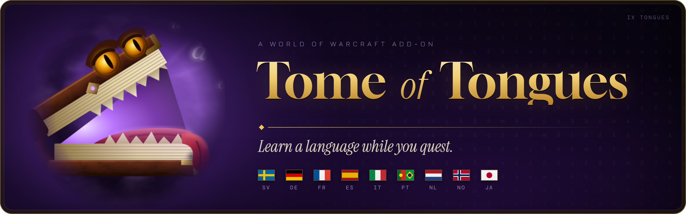
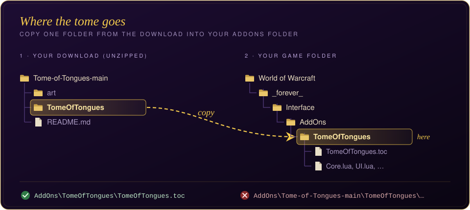

**Hej, adventurer!** Turn every quest into a language lesson. Tome of Tongues swaps words in NPC dialogue into one of 9 languages, then a strange tome pops up to quiz you. Typos forgiven, synonyms welcome. Get it right and more words turn foreign, until whole sentences do. Get it wrong and the tome backs off a little.

Built for **WoW Forever**.

## Languages
Every language covers the same ~440 words and phrases, including plurals and whole phrases
like *thank you* or *how can I help you*.

| Code | Language | File |
|---|---|---|
| sv | Swedish (Svenska) | `Swedish.lua` |
| de | German (Deutsch) | `German.lua` |
| fr | French (Français) | `French.lua` |
| es | Spanish (Español) | `Spanish.lua` |
| it | Italian (Italiano) | `Italian.lua` |
| pt | Portuguese (Português) | `Portuguese.lua` |
| nl | Dutch (Nederlands) | `Dutch.lua` |
| no | Norwegian (Norsk) | `Norwegian.lua` |
| ja | Japanese (romaji) | `Japanese.lua` |

Japanese is written in Latin letters (romaji), because the English game font can't draw
Japanese script. If accented letters (é, ö, ñ...) show as boxes, type `/tot plain`.

## A note from me
I made this small add-on because I needed to learn a language quickly, and I also wanted to keep
grinding the game. This is the solution I came up with for doing both at once.

It hasn't been tested pedagogically in any way, and it's probably not the most efficient way to
learn. It works for me, and I hope it works for you too, but it will never replace a person whose
job is teaching languages.

The word lists rely heavily on AI, because I don't speak most of these languages. If you spot a
wrong word or want to improve a language, contributions are very welcome.

## Install
1. Download this repo (**Code → Download ZIP**) and unzip it.
2. Copy the `TomeOfTongues` folder into
   `World of Warcraft\_forever_\Interface\AddOns\`.
3. Restart the game and tick **Tome of Tongues** under AddOns on the character screen.

## How it works
- **Where:** quest text (accept, progress, turn-in, greeting) and NPC gossip text.
- **Pop-up:** up to 3 questions per dialogue, under a banner in the language's flag colours.
  Type the English meaning and press Enter.
  - Synonyms count.
  - Small typos count ("qeen", "dgo"), plus endings like "kills" or "to kill".
  - **Don't know** shows the answer and costs a little. Closing the pop-up costs nothing.
- **Progression:** every answer nudges a raw skill value, and the level that drives swapping
  follows it gradually, so one bad answer only lowers it a little.
  - Gains get smaller near the top, and wrong answers cost more the higher you are.
- **Unlocks:** word tiers 1 to 4 unlock at levels 0, 15, 35 and 55. Phrases unlock at 65.
  From 85 on, whole sentences can switch.
- **Ranks:** Apprentice → Journeyman → Expert → Artisan → Master → Grand Master.
- Each language keeps its own progress.

## Commands (`/tot` or `/tome`)
| Command | Does |
|---|---|
| `/tot` | Your standing. Use the arrows at the top to switch language |
| `/tot lang <name>` | Study another language (`/tot lang german`, `/tot lang ja`) |
| `/tot langs` | List all languages and your level in each |
| `/tot pause` / `/tot on` | Stop or resume swapping |
| `/tot quiz` / `/tot quiz N` | Toggle pop-ups / set max per dialogue |
| `/tot color` | Toggle highlighting of foreign words |
| `/tot plain` | Strip accents (é → e) |
| `/tot test <text>` | Swap words in any sentence (or a built-in one) and open the quiz pop-up |
| `/tot level N` | Set the current language's level by hand |
| `/tot reset confirm` | Start the current language over (`/tot reset all confirm` for all) |

## Adding words or languages
- Each language has its own file (`German.lua`, `French.lua`, …) with `english = foreign`
  entries, separated by `;` or new lines. The English word must be one that appears in
  `Swedish.lua`, since that's where its tier and extra answers come from.
- To fix a word, edit that language's file and open a pull request.
- To add a language, copy one of those files, change the code, name and words, and add the
  file to `TomeOfTongues.toc`. Add a flag for it in `FLAG_PAINTERS` in `UI.lua`.

